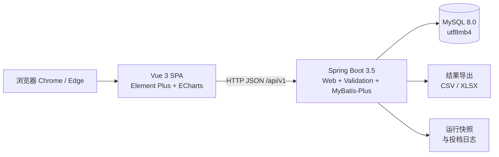

# 技术选型与环境说明

| 项目 | 内容 |
| --- | --- |
| 文档编号 | ENV-01 |
| 版本 | v1.1 |
| 制定日期 | 2026-11-17 |
| 最后修订 | 2026-11-19（环境实测复核、路径描述更正） |
| 制定人 | 庞华杰（组长） |
| 状态 | 组内评审（M1 会前自检完成，待 2026-11-20 评审确认） |

> 本文档回答两个问题：**系统用什么技术实现**、**每台开发机要装什么、怎么验证**。文中标注“目标形态”的命令与目录，随第 3 周工程骨架落地；当前仓库尚无可运行代码。

## 1. 选型原则

1. **可复现**：版本写清、构建用 Wrapper、依赖锁定，换一台机器能按文档跑通。
2. **正确性优先**：技术选择服务于录取规则、事务一致性和可核对性，界面美观不作为首要目标。
3. **团队可维护**：优先选组内课程接触过、资料充足的技术，降低学习成本。
4. **规模可行**：15 万考生、约 500 所初中、150 所高中为规模目标，需支持批量处理与可接受的运行时间。
5. **可测试**：核心投档逻辑与数据库解耦，便于先做小数据断言测试。

## 2. 系统形态与总体架构

前后端分离的单体应用：浏览器访问 Vue 3 单页应用，通过 `/api/v1` 调用 Spring Boot 服务，数据落 MySQL；投档计算在服务端事务内完成，结果与余额、结转流水同库保存。



**部署单元**：前端静态资源 + 后端 jar + MySQL。开发期前端用 Vite 开发服务器代理 `/api` 到 8080；演示/交付期前端打包为静态文件，由 Nginx 或 Spring Boot 静态资源托管。

## 3. 运行环境基线

### 3.1 版本清单

| 类别 | 工具 | 版本基线 | 必需性 | 说明 |
| --- | --- | --- | --- | --- |
| 运行时 | JDK | 21 LTS（21.0.x） | 必需 | Spring Boot 3.5 要求 Java 17+，选 21 LTS；推荐 Temurin 或 Microsoft Build of OpenJDK |
| 构建 | Maven | 3.9+（用 Wrapper 固定） | 必需 | 统一执行 `mvnw` / `mvnw.cmd`，避免本机 Maven 版本差异 |
| 前端运行时 | Node.js | 24 LTS（≥22.12 亦可） | 必需 | Vite 7 要求 Node 20.19+ / 22.12+ |
| 包管理 | npm | 11.x（随 Node 提供） | 必需 | 提交 `package-lock.json`；不要求安装 pnpm/yarn |
| 数据库 | MySQL | 8.0.x（8.0.36+，兼容 8.4） | 必需 | InnoDB、utf8mb4；本地安装或 Docker 均可 |
| 版本控制 | Git | 2.40+ | 必需 | 分支、PR、里程碑 tag |
| 容器 | Docker Desktop + Compose v2 | 4.30+ | 可选（推荐） | 一键起 MySQL，保证 CI 与本机一致；未装时用本机 MySQL |
| 后端 IDE | IntelliJ IDEA | 2025.x+（社区版可用） | 可选 | Maven 导入、断点调试 |
| 前端 IDE | VS Code | 1.9x+ + Vue - Official 扩展 | 可选 | TypeScript / Vue 支持 |
| 数据库工具 | DBeaver / Navicat / MySQL Workbench | 较新版本 | 可选 | 查数、对账、导出 |
| 接口调试 | curl / Postman / IDEA HTTP Client | 任意 | 可选 | 验证 REST 接口 |
| 压测 | JMH 1.37、JMeter 5.6.3 | 可选 | 说明 | JMH 测核心算法，JMeter 测接口 |
| 绘图 | Mermaid（Markdown 内嵌）、draw.io | 可选 | 说明 | ER 图、架构图、流程图 |
| 浏览器 | Chrome / Edge | 最近两个大版本 | 必需 | 前端演示与验收 |

### 3.2 当前开发机核查结果（2026-11-19 复核，初版 2026-11-17）

| 项目 | 实际值 | 状态 |
| --- | --- | --- |
| 操作系统 | Windows 11 家庭版（中文），10.0.26300 | 可用 |
| 内存 | 31.3 GB（32,811,832 KB） | 满足 15 万规模压测 |
| 项目路径 | `D:\Student-Zhongkao-Admission-System`（纯 ASCII） | 符合 DEC-09 |
| 磁盘可用（D:） | 约 41 GB | 满足开发与演示数据预留 |
| JDK | Microsoft Build of OpenJDK 21.0.12 LTS | 已具备 |
| Maven | Apache Maven 3.10.0（`D:\Maven\apache-maven-3.10.0`） | 已具备 |
| Node.js | v24.17.0 | 已具备 |
| npm | 11.13.0 | 已具备 |
| Git | 2.55.0（credential.helper = manager） | 已具备 |
| MySQL | 8.0.46，Windows 服务 `MySQL80` 运行中，端口 3306 | 已具备（客户端需加入 PATH 或用工具连接） |
| Docker | 未安装 | 选装；不装则用本机 MySQL |

> 换机器时按上表逐项核对，版本不低于基线即可；JDK 与 Node 的大版本必须一致，避免编译/构建差异。

## 4. 技术栈明细

### 4.1 后端

| 分层 | 技术 | 版本 | 用途 |
| --- | --- | --- | --- |
| 语言/运行时 | Java | 21 LTS | 主开发语言 |
| 框架 | Spring Boot | 3.5.x | Web、依赖注入、配置、事务 |
| Web | Spring Web MVC | 随 Boot | REST 接口 |
| 校验 | Spring Validation（Jakarta Validation） | 随 Boot | 入参校验与错误提示 |
| 持久层 | MyBatis-Plus | 3.5.x | SQL 可控、批量操作、分页 |
| 数据库迁移 | Flyway（含 `flyway-mysql`） | 随 Boot 管理 | 建表与版本化脚本 |
| 连接池 | HikariCP | 随 Boot | 连接池 |
| 驱动 | MySQL Connector/J | 随 Boot 管理 | JDBC 驱动 |
| 接口文档 | SpringDoc OpenAPI | 2.8.x | 自动生成接口文档 |
| 监控 | Spring Boot Actuator | 随 Boot | 健康检查、运行指标 |
| 工具库 | Lombok（可选） | 随 Boot 管理 | 减少样板代码；是否使用由组内定 |

### 4.2 前端

| 分层 | 技术 | 版本 | 用途 |
| --- | --- | --- | --- |
| 框架 | Vue | 3.5.x | 单页应用 |
| 语言 | TypeScript | 5.x | 类型约束 |
| 构建 | Vite | 7.x | 开发服务器与打包 |
| 路由/状态 | Vue Router 4.x、Pinia 3.x | — | 页面路由与全局状态 |
| UI | Element Plus | 2.x | 表格、表单、分页等组件 |
| 图表 | ECharts | 5.6+ | 分数分布、完成率等统计图 |
| HTTP | Axios | 1.x | 接口请求与拦截器 |
| 单元测试 | Vitest | 3.x | 工具函数与组件测试 |
| 端到端（可选） | Playwright | 1.5x | 关键流程回归 |

### 4.3 数据库与工程工具

| 项目 | 选择 | 说明 |
| --- | --- | --- |
| 数据库 | MySQL 8.0.x | 字符集 `utf8mb4`，排序规则 `utf8mb4_0900_ai_ci`，时区 `+08:00` |
| 迁移 | Flyway | `V1__init_schema.sql` 起顺序编号，禁止修改已执行脚本 |
| 单元测试 | JUnit 5 + AssertJ + Mockito | 核心规则纯逻辑测试，不依赖数据库 |
| 集成测试 | Testcontainers（MySQL 模块） | 在 CI 或有 Docker 的机器执行；无 Docker 时跳过并说明 |
| 覆盖率 | JaCoCo | 规则模块目标行覆盖 ≥ 85%，整体 ≥ 70% |
| 构建 | Maven Wrapper | `./mvnw verify` 一条命令完成编译与测试 |
| 持续集成 | GitHub Actions | push/PR 触发后端测试与前端构建 |
| 配置管理 | Spring Profile + 环境变量 | `local` 配置不入库，密码走环境变量 |
| 文档 | Markdown + Mermaid | 与代码同仓库，随代码评审 |

## 5. 选型理由与备选对比

| 维度 | 选择 | 主要理由 | 未选方案与原因 |
| --- | --- | --- | --- |
| 后端 | Java 21 + Spring Boot 3.5 | 课程与组内基础最匹配；事务、批处理、连接池成熟；15 万规模性能可预期；资料多，答辩易解释 | FastAPI：开发快但大规模批处理与事务表达弱于 Java；NestJS：组内不熟悉，学习成本高 |
| 数据库 | MySQL 8.0 | 课程通用、工具链完善、本机已装；事务与索引满足对账要求 | PostgreSQL：功能更强但组内环境与资料不如 MySQL 普及；SQLite：并发与大数据量压测说服力不足 |
| 持久层 | MyBatis-Plus | 复杂查询与批量 SQL 可控，便于按计划分页/分桶，性能调优直观 | JPA：复杂统计与批量场景易生成低效 SQL，调优成本高 |
| 前端 | Vue 3 + Element Plus | 上手快、组件全、中文资料多；表格与表单契合管理类界面 | React：学习曲线与状态管理复杂度更高，对本项目收益有限 |
| 构建 | Maven | 课程通用、Wrapper 易用、CI 配置简单 | Gradle：灵活但对本项目无必要，组内熟悉度低 |
| 前端包管理 | npm | Node 自带，零额外安装，锁文件稳定 | pnpm/yarn：需额外安装与配置，收益有限 |
| 部署 | jar + 静态资源；可选 Docker Compose | 交付简单，演示机无需装容器 | 纯 Docker 部署：演示机可能未装 Docker，增加风险 |

> 版本策略：Boot 3.5 是 3.x 系列成熟版本，生态与教学资料完整；若教师要求或组内决定升级 4.x，须在第 2 周建模冻结前评估并更新本文档。

## 6. 工程结构（目标形态）

```text
Student-Zhongkao-Admission-System/
├─ backend/                    # Spring Boot 单体
│  ├─ src/main/java/com/zhongkao/admission/
│  │  ├─ controller/           # REST 接口
│  │  ├─ service/              # 业务编排与投档规则
│  │  ├─ domain/               # 实体与领域模型
│  │  ├─ mapper/               # MyBatis-Plus Mapper
│  │  └─ common/               # 异常、返回体、工具
│  ├─ src/main/resources/
│  │  ├─ application.yml
│  │  └─ db/migration/         # Flyway 脚本
│  └─ src/test/java/           # 单元与集成测试
├─ frontend/                   # Vue 3 + Vite
│  ├─ src/views/               # 数据管理、投档执行、结果、统计、滑档对照
│  ├─ src/api/                 # Axios 封装
│  └─ src/stores/              # Pinia
├─ docs/                       # 计划、设计、测试记录、会议记录
├─ scripts/                    # 数据生成、压测、对账、备份
├─ docker-compose.dev.yml      # MySQL 开发环境（可选）
├─ .github/workflows/ci.yml    # 持续集成
└─ README.md
```

## 7. 环境准备与验证

### 7.1 基础工具检查

```powershell
java -version
mvn -v
node -v
npm -v
git --version
```

预期：JDK 21.x、Maven 3.9+、Node 24.x（≥22.12）、npm 11.x、Git 2.40+。

### 7.2 数据库准备

**方式 A：使用本机 MySQL（当前开发机）**

确认服务运行：

```powershell
Get-Service MySQL80
```

用管理员账号执行初始化（库名、用户名、密码为示例，密码不入库）：

```sql
CREATE DATABASE zhongkao DEFAULT CHARACTER SET utf8mb4 COLLATE utf8mb4_0900_ai_ci;
CREATE USER 'zk_app'@'localhost' IDENTIFIED BY '<本地密码>';
GRANT ALL PRIVILEGES ON zhongkao.* TO 'zk_app'@'localhost';
FLUSH PRIVILEGES;
```

**方式 B：Docker Compose（可选，环境更一致）**

```powershell
docker compose -f docker-compose.dev.yml up -d mysql
```

> 若安装 Docker，注意与已占用 3306 端口的本机 MySQL 冲突；Compose 中改用 3307:3306 并在连接串中相应调整。

### 7.3 获取代码与启动（目标形态）

```powershell
git clone https://github.com/Longqc666/Student-Zhongkao-Admission-System.git
cd Student-Zhongkao-Admission-System\backend
.\mvnw.cmd spring-boot:run "-Dspring-boot.run.profiles=local"

cd ..\frontend
npm ci
npm run dev
```

访问 `http://localhost:5173`；后端 `http://localhost:8080/api/v1`，健康检查 `http://localhost:8080/actuator/health`。

> 统一使用**纯 ASCII 路径**，当前开发机为 `D:\Student-Zhongkao-Admission-System`（DEC-09）。不要克隆到含中文或空格的目录，个别构建工具对中文路径解析不稳定。

## 8. 配置、端口与安全

| 项目 | 约定 |
| --- | --- |
| 数据库 | 库名 `zhongkao`，端口 3306，时区 `Asia/Shanghai` |
| 后端端口 | 8080，接口前缀 `/api/v1` |
| 前端端口 | 5173，开发代理 `/api` → `http://localhost:8080` |
| 敏感配置 | 通过环境变量 `ZK_DB_URL`、`ZK_DB_USERNAME`、`ZK_DB_PASSWORD` 注入；`application-local.yml` 与 `.env` 加入 `.gitignore` |
| 示例配置 | 提交 `application.yml` 与 `.env.example`，只放占位符 |
| 数据合规 | 全部使用虚构数据；不提交真实考生信息、密码、令牌 |
| 日志 | 按运行编号记录投档与跳过原因，便于追溯；日志中不输出密码 |

## 9. 构建、测试与持续集成

### 9.1 本地命令

| 目的 | 命令 |
| --- | --- |
| 后端编译与测试 | `.\mvnw.cmd verify` |
| 仅单元测试 | `.\mvnw.cmd test` |
| 覆盖率报告 | `.\mvnw.cmd verify jacoco:report`（报告在 `backend/target/site/jacoco`） |
| 前端依赖安装 | `npm ci` |
| 前端构建 | `npm run build` |
| 前端单元测试 | `npm run test:unit` |
| 前端类型检查 | `npm run type-check` |

### 9.2 CI 流程（GitHub Actions）

`push` 与 `pull_request` 触发，至少包含：

1. 后端：JDK 21 + `./mvnw -B verify`，使用 MySQL 8.0 service container 或 Testcontainers。
2. 前端：Node 24 + `npm ci` + `npm run build` + `npm run test:unit`。
3. 失败即阻止合并；CI 结果作为 PR 评审依据之一。

### 9.3 测试分层

| 层次 | 范围 | 工具 | 是否依赖数据库 |
| --- | --- | --- | --- |
| 规则单元测试 | 梯度分桶、志愿轮次、排序、结转计算 | JUnit 5 + AssertJ | 否 |
| 服务集成测试 | 投档事务、余额更新、快照与日志 | Spring Boot Test + Testcontainers | 是（CI） |
| 接口测试 | REST 契约与异常返回 | MockMvc | 否/是 |
| 前端测试 | 工具函数与关键组件 | Vitest | 否 |
| 端到端（可选） | 完整录取流程 | Playwright | 是 |

## 10. 性能测试基线（暂定，实测后校准）

| 数据规模 | 数据生成 | 导入与校验 | 四批完整投档 | 峰值内存 | 说明 |
| --- | --- | --- | --- | --- | --- |
| 1 万考生 | ≤ 1 分钟 | ≤ 1 分钟 | ≤ 1 分钟 | ≤ 1 GB | 功能回归基线 |
| 5 万考生 | ≤ 3 分钟 | ≤ 2 分钟 | ≤ 2 分钟 | ≤ 2 GB | 中期压测 |
| 15 万考生 | ≤ 5 分钟 | ≤ 5 分钟 | ≤ 5 分钟 | ≤ 4 GB | 交付验收目标 |

**记录要求**：每次压测保存硬件（CPU/内存/磁盘）、软件版本、数据规模、随机种子、运行次数、各阶段耗时与峰值内存；优化前后用同一快照对比，且必须复核录取结果未变。

**正确性回归**：每次性能优化后重跑小数据断言与对账 SQL，避免“快了但错了”。

## 11. 复现步骤（目标形态，交付前验证）

1. 安装 JDK 21、Node 24、Maven（或直接用 Wrapper）；数据库用本机 MySQL 8.0 或 Docker。
2. 克隆仓库到无中文路径的目录。
3. 建库建用户（见 7.2），配置环境变量。
4. `backend` 下执行 `.\mvnw.cmd verify`，确认测试通过。
5. `backend` 下 `.\mvnw.cmd spring-boot:run "-Dspring-boot.run.profiles=local"`，Flyway 自动建表。
6. `frontend` 下 `npm ci && npm run dev`，浏览器打开 5173。
7. 用 `scripts/` 生成小数据集，按文档完成一次四批完整投档。
8. 依次核对录取名单、计划余额、结转流水与统计报表。

目标：新成员在**30 分钟内**从零跑通（不含下载依赖时间）。

## 12. 已知限制与注意事项

- **未安装 Docker**：当前开发机无 Docker，集成测试依赖 CI 或本机 MySQL；装 Docker 时注意 3306 端口冲突。
- **路径**：统一使用纯 ASCII 路径（当前为 `D:\Student-Zhongkao-Admission-System`）；若克隆到含中文或空格的目录，Java/Node 工具可能出现解析异常，需迁移到 ASCII 路径（DEC-09）。
- **MySQL 客户端未入 PATH**：需使用完整路径或数据库工具执行 SQL。
- **字符集与时区**：统一 `utf8mb4` 与 `Asia/Shanghai`，避免中文姓名、日期跨库不一致。
- **大规模数据**：15 万考生生成的 CSV 可能达数百 MB，不入库、不提交 Git，只提交生成脚本与种子。
- **前端兼容**：只保证 Chrome/Edge 最近两个大版本，不做 IE 兼容。
- **端口占用**：8080/5173 被占用时改端口并同步前端代理配置。
- **AI 使用**：允许使用 AI 辅助，但须在 PR 或 [AI 使用记录](./AI使用记录.md) 中说明使用环节，并由组员核实代码、规则与测试结果（DEC-10）。

## 13. 版本升级与变更

- 依赖版本在 `backend/pom.xml` 与 `frontend/package.json` 中锁定；升级须单独 PR，说明原因并跑全量测试。
- 本文档版本变更同步更新“制定日期/版本”，并在 PR 中说明影响范围。
- 数据库脚本遵循 Flyway 规则：已执行的迁移文件不修改，新增变更写新版本号。

## 14. 变更记录

| 版本 | 日期 | 变更内容 | 变更人 |
| --- | --- | --- | --- |
| v1.0 | 2026-11-17 | 初版：确定 Java/Spring Boot/MySQL/Vue 技术栈、环境基线、目录结构、CI 与性能目标 | 庞华杰 |
| v1.1 | 2026-11-19 | 按实测复核环境（OS、内存、磁盘、路径）；修正 §12“当前目录含中文”的错误描述；明确统一 ASCII 路径与本地 MySQL 方案（DEC-09）；补充 AI 使用记录链接（DEC-10） | 庞华杰 |
