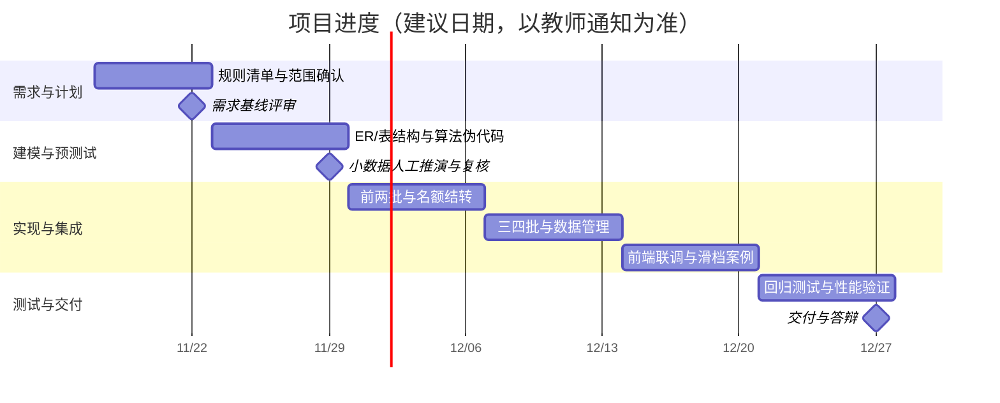

# 阶段计划

| 项目 | 内容 |
| --- | --- |
| 文档编号 | PLAN-01 |
| 版本 | v1.0 |
| 制定日期 | 2026-11-17 |
| 制定人 | 庞华杰（组长） |
| 依据 | 《软件系统开发实践课程设计任务书》 |
| 状态 | 组内评审（待组员确认） |

> 本计划是组内执行安排，不是课程官方日程。周次自 **2026-11-17** 起算，日期为建议值；教师通知的提交、检查与答辩日期确定后，按“倒排 + 最后一周只做测试与交付”的原则调整，并升版本记录变更。

## 1. 计划目标

在 6 周内完成一个**可运行、可复现、可解释**的简化广州中考录取模拟系统，并形成任务书要求的五类交付物：

1. 源代码与完整 Git 版本记录（含数据库初始化脚本、配置示例、依赖说明）。
2. 设计报告（需求与简化范围、架构、数据库、核心算法、界面、测试、分工）。
3. 测试材料（小数据与人工预期、自动化测试、实际结果对照、较大规模演示数据）。
4. 使用与部署说明（环境、初始化、启动、样例数据、操作流程、已知限制）。
5. 演示材料（完整录取一次 + 两项易错边界场景，人人能讲自己负责的模块）。

计划遵循四条硬约束：**先人工预期后编码**；**规则正确性优先于界面**；**每周有可检查产物**；**同一快照重复运行结果一致**。

## 2. 总体节奏

6 周、6 个里程碑，与任务书的四个开发阶段对应（实现阶段占 3 周）：

| 阶段 | 周次 | 日期 | 里程碑 | 阶段负责人 | 退出条件（Gate） |
| --- | --- | --- | --- | --- | --- |
| 一、需求与计划 | 第 1 周 | 11-17 ~ 11-22 | M1 需求基线 | 庞华杰 | G1：规则清单、范围、分工、环境基线评审通过 |
| 二、建模与预测试 | 第 2 周 | 11-23 ~ 11-29 | M2 建模冻结 | 彭清毅 | G2：ER/表结构定稿，小数据人工推演双人复核通过 |
| 三、实现与集成（上） | 第 3 周 | 11-30 ~ 12-06 | M3 前两批贯通 | 庞华杰 | G3：第一、二批及结转与人工预期逐条一致 |
| 三、实现与集成（中） | 第 4 周 | 12-07 ~ 12-13 | M4 四批全流程 | 庞延新 | G4：四批完整投档可跑通，查询统计与明细一致 |
| 三、实现与集成（下） | 第 5 周 | 12-14 ~ 12-20 | M5 功能冻结 | 何奕佳 | G5：界面可演示、两个滑档案例完成、性能初测完成 |
| 四、测试与交付 | 第 6 周 | 12-21 ~ 12-27 | M6 交付 | 庞华杰 | G6：15 万规模跑通，五大交付物齐全，答辩演练通过 |

## 3. 分周任务

标记说明：**交付物**为当周必须进入仓库或群文件的产物；**完成标准**为周评审时的检查依据。

### 第 1 周：需求与计划（11-17 ~ 11-22）

| # | 任务 | 负责人 | 交付物 | 完成标准 |
| --- | --- | --- | --- | --- |
| 1.1 | 逐条梳理任务书规则：批次、控制线与梯度、志愿轮次、同分序号、名额结转、统计口径 | 练悦 | `docs/需求与规则清单.md` v1.0 | 每条规则可定位到任务书条款；无“待理解”遗留项 |
| 1.2 | 确认简化范围与“不做清单”，防止范围蔓延 | 庞华杰 | README「建设目标与范围」更新 | 与任务书第二章一致；组内无异议 |
| 1.3 | 确定技术栈、版本基线与环境搭建方式 | 庞华杰、彭清毅 | `docs/技术选型与环境说明.md` v1.0 | 版本可安装、命令可复现；选型理由成文 |
| 1.4 | 用例与角色梳理（数据管理、投档执行、结果查询、统计导出） | 练悦 | 用例清单（合并进需求文档） | 覆盖任务书四类必做功能 |
| 1.5 | ER 草图与实体初稿 | 彭清毅 | ER 草图 v0.1 | 覆盖高中、初中、考生、计划、资格、志愿、运行、日志八类实体 |
| 1.6 | 小数据集场景设计：2 所初中、3—4 所高中、12—20 名考生、每计划 1—3 人 | 何奕佳 | 场景清单（≤3 个独立场景） | 覆盖梯度优先、同梯度志愿优先、边界分数、结转 |
| 1.7 | 建立仓库协作规范：目录结构、分支、提交、PR、评审 | 庞华杰 | 本计划第 7 节 + README | 全员知会并执行 |
| 1.8 | 在 GitHub 建立 6 个里程碑与任务 issue，关联负责人 | 庞华杰 | Milestones / Issues | 每个任务可追踪，不晚于 M1 前建完 |

**周评审产出**：规则清单、需求文档、技术选型文档、ER 草图、场景清单。

### 第 2 周：建模与预测试（11-23 ~ 11-29）

| # | 任务 | 负责人 | 交付物 | 完成标准 |
| --- | --- | --- | --- | --- |
| 2.1 | ER 图定稿与表结构设计（含主外键、唯一约束、索引） | 彭清毅 | `docs/数据库设计.md` + ER 图 | 满足任务书最低字段要求；冗余余额与结转流水可对账 |
| 2.2 | 数据库初始化脚本（Flyway `V1__init_schema.sql`）与初始化说明 | 彭清毅 | `backend/src/main/resources/db/migration/` | 空库执行一次即可建全表；重复执行有保护 |
| 2.3 | 核心流程与伪代码：批次编排、梯度分桶、志愿轮次、计划内排序、结转幂等 | 庞华杰、庞延新 | `docs/核心算法说明.md` | 能逐轮手算复现任务书附录 B 示例 |
| 2.4 | 模块与接口边界（controller / service / domain / mapper） | 庞华杰 | 接口清单 v0.1 | 各批次模块职责清晰，公共排序组件可复用 |
| 2.5 | 小数据集完整输入：规则参数、学校与计划、考生与资格、志愿 | 何奕佳 | `docs/testdata/` 输入表（CSV/Markdown） | 数据能直接导入；覆盖每批录取与未录取情形 |
| 2.6 | 逐轮人工推演：各批录取名单、余额、最低分、末位考生 | 全员，何奕佳汇总 | `docs/testdata/预期结果.md` | 双人独立推演一致；先于任何系统输出完成 |
| 2.7 | 预测试评审（M2） | 庞华杰 | 评审记录 `docs/meetings/` | G2 通过方可进入编码 |

**关键纪律**：人工预期必须由人推演并签字确认，**不得用系统运行结果反填预期**。

### 第 3 周：前两批与名额结转（11-30 ~ 12-06）

| # | 任务 | 负责人 | 交付物 | 完成标准 |
| --- | --- | --- | --- | --- |
| 3.1 | 工程骨架：`backend/`、`frontend/`、Maven Wrapper、CI、`.gitignore` | 庞华杰 | 可编译运行的骨架提交 | `./mvnw verify` 通过；`npm run build` 通过 |
| 3.2 | 第一批自主招生：志愿、资格名单、计划控制线、考核排名 | 庞华杰 | 第一批服务与单元测试 | 未获资格/未达线不录取；按排名录至满额 |
| 3.3 | 第二批名额分配：按“高中 + 初中”独立计划投档 | 廖浩廷 | 第二批服务与隔离测试 | 不挤占其他初中名额；跨批次排除正确 |
| 3.4 | 批次衔接与结转流水：一、二批余额转入第三批，只转一次 | 庞华杰 | 结转服务、流水表、幂等测试 | 重复执行不叠加；余额平衡式成立 |
| 3.5 | 四批计划余额冗余结构及同步更新 | 彭清毅 | 余额表、更新逻辑、对账 SQL | 初始 + 转入 − 转出 = 录取 + 剩余 |
| 3.6 | 数据导入与校验：重复考生、非法分数、重复志愿、无效计划、重复同分序号 | 练悦 | 导入接口、校验规则与测试 | 异常数据被拒绝并给出可读原因 |
| 3.7 | 小数据断言测试（前两批）与测试基线 | 何奕佳 | 自动化测试 + 对照表 | 与人工预期逐条一致，差异为 0 |

### 第 4 周：第三、四批与数据管理（12-07 ~ 12-13）

| # | 任务 | 负责人 | 交付物 | 完成标准 |
| --- | --- | --- | --- | --- |
| 4.1 | 第三批统招：批次 → 梯度降序 → 志愿轮次 → 总分降序/同分序号升序 | 庞延新 | 第三批服务与边界测试 | 满足任务书“同梯度志愿优先、不同梯度梯度优先” |
| 4.2 | 第四批统招复用同一投档内核，验证批次隔离 | 庞延新 | 第四批实现与测试 | 第三、四批余额不互转 |
| 4.3 | 投档执行编排：分批/完整运行、进度、输入快照、已完成输入不可静默修改 | 庞华杰 | 运行服务、快照表 | 重新运行生成独立结果，不叠加旧录取 |
| 4.4 | 可复现虚构数据生成器：种子/配置、约 500 初中、150 高中、15 万考生 | 练悦 | `scripts/` 生成器与说明 | 同种子结果一致；生成的志愿合法 |
| 4.5 | 索引、批量写入与对账工具 | 彭清毅 | 迁移脚本 V2 + 对账 SQL | 关键查询走索引；对账一键出结果 |
| 4.6 | 查询功能：考生去向与志愿处理、按校/初中/批次/计划名单与余额、未录取原因 | 何奕佳 | 查询接口与页面 | 原因可解释：低于控制线、名额已满、资格不符、前批已录取 |
| 4.7 | 统计功能：计划数、录取数、完成率、未录取数、分数分布、最低分、末位考生 | 何奕佳 | 统计接口与页面 | 最低分与末位考生分别计算，无人录取显示“无” |
| 4.8 | 集成联调：后端 API + 简版前端跑通四批流程 | 全员 | 联调记录 | G4 通过 |

### 第 5 周：前端完善、滑档案例与性能初测（12-14 ~ 12-20）

| # | 任务 | 负责人 | 交付物 | 完成标准 |
| --- | --- | --- | --- | --- |
| 5.1 | 前端框架与页面：数据管理、投档执行、结果查询、统计、滑档对照 | 何奕佳（框架/统计）、练悦（数据管理）、各模块负责人补页面 | 可演示前端 | 主流程无阻塞；错误提示可读 |
| 5.2 | 结果导出（CSV/XLSX）与分页 | 何奕佳 | 导出接口与测试 | 大数据量不内存溢出 |
| 5.3 | 滑档案例一：某批次未录取 | 庞华杰、何奕佳 | 案例数据 + 过程截图 + 原因说明 | 数据完整、可复现、结论与系统一致 |
| 5.4 | 滑档案例二：全部批次未录取；含同梯度低分因志愿靠前被录、高分因志愿靠后落选 | 庞延新、廖浩廷 | 案例数据 + 人工推演 + 对照报告 | 仅调整该生志愿重跑，前后结果对比成立 |
| 5.5 | 性能初测：1 万、5 万考生完整运行，记录耗时/内存/瓶颈 | 彭清毅、何奕佳 | 压测记录 | 有基线数据与优化清单 |
| 5.6 | 文档同步：README 更新、设计报告框架搭建 | 练悦 | README、`docs/设计报告.md` 框架 | 文档与代码一致，无“已实现”虚标 |

### 第 6 周：测试与交付（12-21 ~ 12-27）

| # | 任务 | 负责人 | 交付物 | 完成标准 |
| --- | --- | --- | --- | --- |
| 6.1 | 回归测试：边界、异常、幂等、对账、重复运行全量执行 | 何奕佳 | 测试报告 | 必测场景 12 项全覆盖，失败项清零或登记 |
| 6.2 | 15 万考生完整运行与性能记录（环境、数据、耗时、内存） | 彭清毅、何奕佳 | 性能报告 | 可重复执行；结果与明细对账一致 |
| 6.3 | 设计报告定稿（需求、架构、DB、算法、界面、测试、分工与总结） | 练悦 | `docs/设计报告.md` | 图表解释设计；个人贡献可核对 |
| 6.4 | 使用与部署说明：环境、初始化、启动、样例数据、操作流程、已知限制 | 庞华杰 | `docs/使用与部署.md` | 新成员照文档 30 分钟内跑通 |
| 6.5 | 演示脚本与答辩分工：完整录取一次 + 两项边界场景 | 全员 | 演示脚本、讲解分工 | 每人能讲清本人模块与关键规则 |
| 6.6 | 交付清单核对、打 tag `v1.0`、材料归档 | 庞华杰 | Release 页与材料目录 | G6 通过 |

## 4. 分工与工作量

以六人均衡为目标，每人主责一个工作包，同时参与需求评审、代码评审和测试。贡献占比按实际记录核定，初步目标为每人约 1/6；不以代码行数作为唯一依据。

| 成员 | 主责模块 | 第 3—5 周重点 | 主要交付物 |
| --- | --- | --- | --- |
| 庞华杰（组长） | 项目协调、规则与接口统筹、第一批、批次衔接 | 工程骨架、结转幂等、投档编排、滑档案例一 | 阶段计划、第一批实现、结转流水、案例一 |
| 练悦 | 需求梳理、文档规范、基础数据管理与校验 | 导入校验、虚构数据生成器、数据管理页、报告 | 需求清单、生成器、校验测试、设计报告 |
| 彭清毅 | 数据建模、数据库与持久化、余额冗余结构 | 表结构、索引、批量写入、对账、性能排查 | ER 图、建表脚本、对账方案、性能记录 |
| 廖浩廷 | 第二批名额分配与初中名额隔离 | 第二批投档、隔离测试、滑档案例二支撑 | 第二批实现、隔离测试、案例数据 |
| 庞延新 | 第三、四批统招与梯度/志愿处理 | 公共排序组件、三四批实现、边界测试 | 统招实现、排序与边界测试 |
| 何奕佳 | 结果查询、统计导出、测试组织 | 查询统计、导出、滑档对照、测试与性能组织 | 查询统计、测试方案、对照报告 |

**交叉复核**：第一批与结转由彭清毅复核；第二批由庞延新复核；第三、四批由廖浩廷复核；统计口径由练悦复核。复核人需在 PR 中留下检查意见。

## 5. 质量门禁与验收标准

### 5.1 门禁

| 门禁 | 时点 | 通过标准（缺一不得进入下一阶段） |
| --- | --- | --- |
| G1 需求基线 | M1 | 规则清单、范围、分工、技术栈确认；文档评审通过 |
| G2 预测试通过 | M2 | 小数据输入齐全；人工逐轮推演完成并双人复核；覆盖梯度、志愿、边界、结转 |
| G3 前两批通过 | M3 | 前两批与结转结果同人工预期逐条一致；余额平衡；结转幂等 |
| G4 全流程 | M4 | 四批完整运行；查询、统计与明细一致；未录取原因可解释 |
| G5 功能冻结 | M5 | 前端可演示；两个滑档案例完成；1 万/5 万性能初测完成；无阻塞缺陷 |
| G6 交付 | M6 | 15 万规模跑通；五大交付物齐全；部署文档可复现；答辩演练通过 |

门禁未通过时不得并行开展后续核心开发；确需并行须组长批准并在周评审记录中登记风险。

### 5.2 系统约束核对（任务书“必须满足的系统约束”）

| 约束 | 实现手段 | 验证方式 |
| --- | --- | --- |
| 每名考生每次模拟最多录取一次 | 录取表唯一约束 + 考生状态机 | 重复投档测试、全量 SQL 查重 |
| 每条计划录取人数不超过有效名额 | 余额扣减与事务内校验 | 超额检查 SQL、并发/重复运行测试 |
| 每条录取均对应有效志愿且满足资格与分数 | 投档前过滤 + 落库前二次校验 | 明细抽样 + 约束查询 |
| 初始名额 + 转入 − 转出 = 已录取 + 剩余 | 余额冗余字段 + 结转流水 | 一键对账 SQL |
| 汇总统计与明细一致 | 统计复用同一口径查询 | 明细汇总与统计表比对 |

### 5.3 必测场景覆盖

| 场景 | 验证要点 | 主责 | 完成阶段 |
| --- | --- | --- | --- |
| 梯度优先 | 高梯度后志愿优先于低梯度前志愿 | 庞延新 | 第 4 周 |
| 同梯度志愿优先 | 同梯度低分第一志愿先于高分第二志愿 | 廖浩廷 | 第 3 周 |
| 分数与同分顺序 | 同梯度同志愿先比总分，再比同分序号 | 庞延新 | 第 4 周 |
| 边界分数 | 等于控制线/梯度线可进入，低 1 分进入低档或不具资格 | 庞延新 | 第 4 周 |
| 自主招生 | 未获资格、未达控制线不录取；达线按考核排名 | 庞华杰 | 第 3 周 |
| 跨批次排除 | 前批录取者不占后续计划，落选者可继续 | 庞华杰 | 第 3 周 |
| 名额分配隔离 | 只使用所属初中名额 | 廖浩廷 | 第 3 周 |
| 名额结转 | 余额转入第三批且只转一次 | 庞华杰 | 第 3 周 |
| 不足额与空结果 | 不强行录满；无人录取时最低分与末位显示“无” | 廖浩廷 | 第 4 周 |
| 统计口径差异 | 最低录取分与末位考生分别计算，不混用 | 何奕佳 | 第 4 周 |
| 异常输入 | 重复考生、非法分数、重复志愿、无效计划、重复同分序号被拒 | 练悦 | 第 3 周 |
| 可重复运行 | 同一快照结果一致，不叠加旧录取 | 彭清毅 | 第 4 周 |

## 6. Git 协作规范

- **分支**：`main` 保持可运行；功能用 `feat/<模块>-<简述>`，修复用 `fix/<简述>`，文档用 `docs/<简述>`。
- **提交信息**：`类型(范围): 说明`，例如 `feat(admission): 实现第二批初中名额隔离`、`test(admission): 补充梯度边界用例`。一次提交只做一件事。
- **Pull Request**：关联 issue；写清变更内容、验证命令、自测结果；CI 通过且至少 1 名组员 review 后合并；合并后删除分支。
- **节奏**：每周日 22:00 前完成当周合并；每个里程碑打 tag（`v0.1-m1` … `v1.0`）；每人每周至少 2 次有意义提交，禁止最后一次性导入全部代码。
- **禁止提交**：构建产物（`target/`、`dist/`、`node_modules/`）、数据库密码与密钥、真实个人信息、与项目无关的大文件。
- **冲突处理**：每日开工前 `git pull --rebase`；冲突由当日提交人负责解决并通知对方，不得强推 `main`。
- **会议记录**：`docs/meetings/YYYY-MM-DD.md`，记录决议、待办、责任人和期限。

## 7. 风险与应对

| 风险 | 影响 | 概率 | 应对措施 | 责任人 |
| --- | --- | --- | --- | --- |
| 规则理解偏差（梯度、志愿轮次、结转） | 高 | 中 | 规则清单逐条对照任务书；小数据人工推演；双人复核；关键规则写测试 | 庞华杰 |
| 期末课程冲突导致投入不足 | 高 | 中 | 6 周计划留第 6 周缓冲；每周检查点暴露进度；任务可拆小 | 庞华杰 |
| 15 万规模性能不达标 | 中 | 中 | 内存分桶、批量写入、索引、分阶段压测；必要时降级为 5 万演示并说明 | 彭清毅 |
| Git 协作混乱或代码被覆盖 | 中 | 中 | 分支 + PR + review；禁止强推；每日同步 | 练悦 |
| 开发环境不一致 | 中 | 中 | 版本锁定、Maven Wrapper、CI、可选 Docker Compose | 彭清毅 |
| 名额结转重复或账不平 | 高 | 低 | 幂等键 + 唯一约束 + 对账 SQL + 重复执行测试 | 庞华杰 |
| 测试记录倒推、预期造假 | 高 | 低 | 预期先提交并打 tag；保留推演原始记录；评审抽查 | 何奕佳 |
| 前端页面进度落后 | 中 | 中 | 第 4 周先跑通简版页面；组件复用；必要时降低视觉要求保功能 | 何奕佳 |

## 8. 会议与沟通

- **周站会**：每周一 20:00，15 分钟，每人回答“上周完成 / 本周计划 / 阻塞”。
- **周评审**：每周五 21:00，30—60 分钟，逐项对照当周完成标准与门禁，形成会议记录。
- **异步沟通**：问题进 issue 或群待办，不留在私聊；关键决策由组长在 issue 中确认并同步文档。
- **验收演练**：第 6 周至少 2 次完整演示彩排，按任务书“每位成员解释负责模块”的要求轮讲。

## 9. 变更控制

- 规则、数据模型、接口的变更需提 issue 说明原因与影响，经组长和相关模块负责人确认后实施。
- 需求基线（M1）与建模冻结（M2）后，变更须在周评审记录中登记，并同步更新规则清单、测试预期和设计文档。
- 每次计划调整更新本文档版本号与变更记录，避免“计划与实际两张皮”。

## 10. 待确认事项

| 事项 | 说明 | 责任人 | 期限 |
| --- | --- | --- | --- |
| 教师通知的提交与答辩日期 | 决定是否将 6 周压缩为 5 周，需提前倒排 | 庞华杰 | 第 1 周内 |
| 组员技术基础摸底（Java/Vue/SQL） | 决定页面与模块再分配，必要时结对 | 庞华杰 | 第 1 周内 |
| 是否统一安装 Docker Desktop | 当前开发机未安装；影响环境一致性与集成测试方式 | 彭清毅 | 第 1 周内 |
| 课程是否限定语言或数据库 | 若教师有指定，以通知为准调整选型 | 庞华杰 | 第 1 周内 |
| 15 万规模演示机器 | 确认演示电脑内存与耗时，决定现场演示还是录屏 | 何奕佳 | 第 5 周内 |

## 11. 变更记录

| 版本 | 日期 | 变更内容 | 变更人 |
| --- | --- | --- | --- |
| v1.0 | 2026-11-17 | 初版：6 周里程碑、分工、门禁、风险与协作规范 | 庞华杰 |
